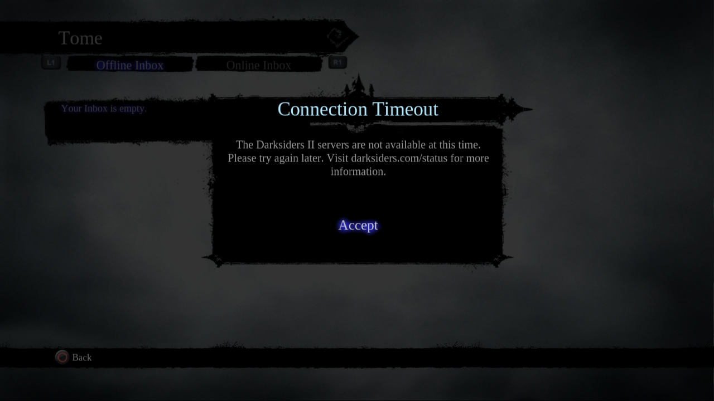
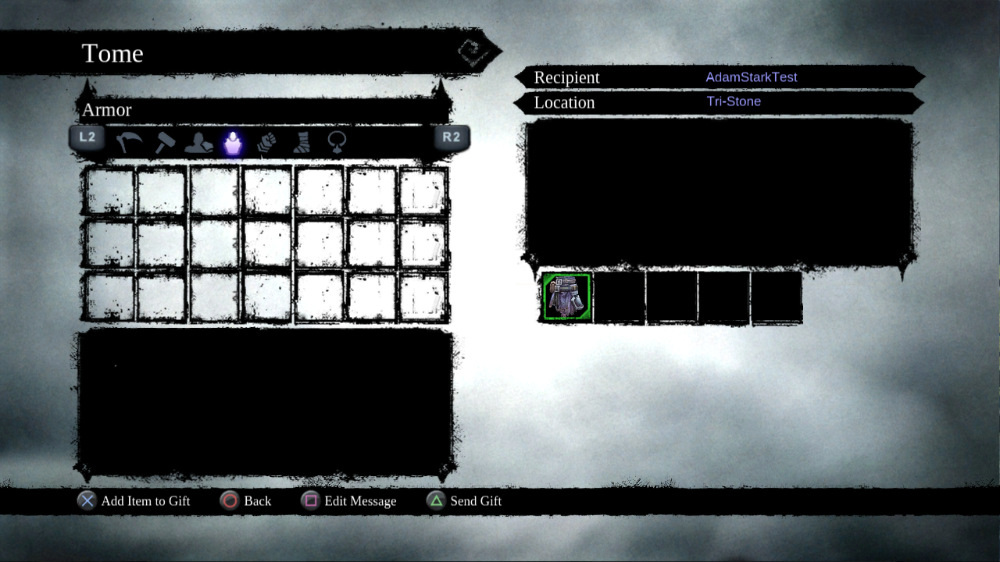
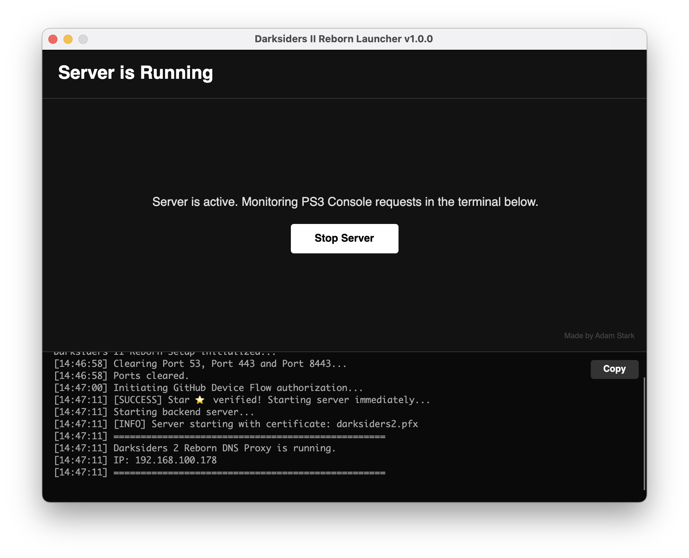

# Darksiders 2 Reborn PS3
> [!IMPORTANT]
> This project brings back the Online Mailbox functionality and the "Pay It Forward" trophy for Darksiders II.

A cross-platform custom server and launcher to restore the Platinum trophy and Online Mailbox functionality for **Darksiders II** on the PlayStation 3.

|             BEFORE: Server Error              |             AFTER: Server Online             |
|:---------------------------------------------:|:--------------------------------------------:|
|  |  |

These screenshots are from Darksiders II using RPCS3.

## Download
**Please leave a star ⭐ if you found this repository helpful!**  
📅 **TBD (currently testing OFW):** Release 1.0.0 is here!

You can download the compiled versions for your operating system here:  
**[Download Latest Release.](https://github.com/adamstark1/Darksiders2-Reborn-PS3/releases)**

| UI Screenshot |
| :---: |
|  |

## How to Run
> [!NOTE]
> The application was tested on Windows 11, macOS Tahoe and Ubuntu 22.04.
### Windows
1. Extract the downloaded `.zip` file or compile it yourself with `Compilers/build_windows.sh` (use [Git Bash](https://git-scm.com/install/) terminal).
2. Run `Darksiders2Reborn.Launcher.exe`.

### macOS
1. Extract the downloaded `.zip` file or compile it yourself with `Compilers/build_mac_silicon.sh` or `Compilers/build_mac_intel.sh`.
2. Double-click the `Darksiders II Reborn.app` bundle. 

### Linux
1. Extract the downloaded `.zip` file or compile it yourself with `Compilers/build_linux.sh` and run `install.sh`.
2. Run `Darksiders II Reborn` from application menu. 

## Setup Instructions

1. **Clear Ports:** Click the button in the Launcher to free Port 53 (DNS), Port 443 and Port 8443 (HTTPS). These are required for the application to intercept PS3 traffic.
2. **Select Platform:** Select PS3 or [RPCS3](https://rpcs3.net/download) (emulator). For RPCS3, you'll have to do the steps down below as well. If you're on PS3, skip to Step 3.
    * Open RPCS3, click Utilities, then **Decrypt PS3 Binaries**.
    * Find your EBOOT.BIN file under `RPCS3/dev_hdd0/game/NPEB00902/USRDIR` and open it. RPCS3 will now generate an ELF file.
    * Download [patch_eboot.sh](https://github.com/adamstark1/Darksiders2-Reborn-PS3/tree/main/RPCS3) and launch it with `./patch_eboot.sh <path_to_eboot.elf>` from Terminal (use [Git Bash](https://git-scm.com/install/) terminal on Windows).
    * Delete/rename the original EBOOT.BIN file.
    * Place the patched BIN into your game's `USRDIR` folder.
3. **PS3 Network Configuration:**
    * On your PS3, go to **Settings > Network Settings > Internet Connection Settings**.
    * Select **Custom**.
    * Select **Wired Connection** or **Wireless**.
    * Go through the settings normally until you reach **DNS Setting**.
    * Select **Manual**.
    * Enter the IP address shown in the Launcher as your **Primary DNS**.
    * Leave the **Secondary DNS** blank (or `0.0.0.0`).
    * Save settings and test the connection.
4. **Optional Step:** Open the **Internet Browser** on your PS3 and head to https://ds2.gds.thqconnect.com/. If you see my message, you're perfectly set.
5. **Start Server:** Once the DNS is set, click "Start Server". The terminal will display your local IP address. Boot the game.

## Sponsors and Contributors
I'd like to give a huge thank you to everyone who helped with this repository. This projects improves overtime thanks to you! Credit to [frrstgvmp's](https://github.com/frrstgvmp/darksiders2-ps3-mail-server) repository for mapping the missing API endpoints that I wasn't able to find with [Ghidra](https://github.com/NationalSecurityAgency/ghidra/releases).

❤️ **Sponsors:** [@ffv2-droid](https://github.com/ffv2-droid)  
🛠️ **Troubleshooting:** -

You can support my coding journey and revival projects on [GitHub Sponsors](https://github.com/sponsors/adamstark1).

## Troubleshooting

>**"Port 53, Port 443 or Port 8443 in use / Server fails to start"**  
If the built-in port clearer fails, manually kill the conflicting processes:
- **macOS:** Open Terminal and run `sudo kill -9 $(sudo lsof -t -i :443 -i :8443)`.
- **Linux:** Open Terminal and run `sudo fuser -k 443/tcp 8443/tcp 53/udp`.
- **Windows:** Open Command Prompt as Administrator and run `for /f "tokens=5" %a in ('netstat -aon ^| findstr :443 ^| findstr LISTENING') do taskkill /f /pid %a`, then repeat for `:8443`.

Executing these commands will free up the necessary ports, and the Launcher will function properly.

>**"Permission denied for compiler/RPCS3 .sh scripts"**  
Adjust permissions for these files manually:
* **macOS (Intel):** use `chmod +x build_mac_intel.sh` in Terminal.
* **macOS (Silicon):** use `chmod +x build_mac_silicon.sh` in Terminal.
* **Linux:** use `chmod +x build_linux.sh` in Terminal.
* **Windows:** use `chmod +x build_windows.sh` in Git Bash terminal.

## Tech Stack

* **Backend:** ASP.NET Core (Kestrel web server)
* **DNS Routing:** Custom DNS proxy handling UDP port 53 traffic to reroute PSN URLs to the local host.